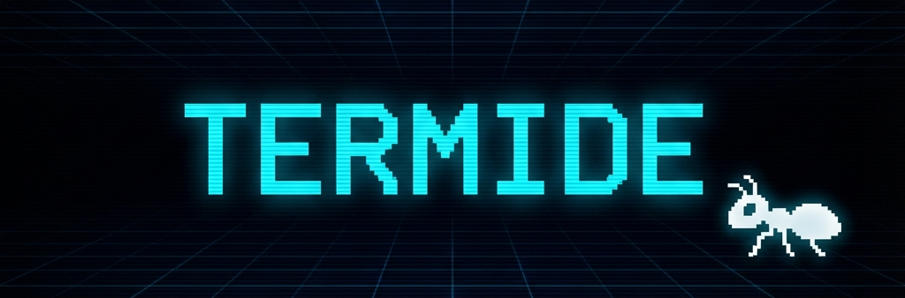

<p align="center">
  
</p>

<h3 align="center">🐜 Terminal-First IDE for AI Coding Agents</h3>

<p align="center">
  <strong>Fast. Elegant. Keyboard-driven.</strong>
</p>

<p align="center">
  <a href="https://www.npmjs.com/package/termide"></a>
  <a href="https://github.com/Nachx639/termide/stargazers"></a>
  <a href="https://github.com/Nachx639/termide/blob/main/LICENSE"></a>
  
  
</p>

---

<p align="center">
  
</p>

---

## ✨ Why termide?

**termide** is a minimalist, terminal-native IDE built for developers who:
- 🤖 Work with **AI coding assistants** (Claude Code, Aider, etc.)
- ⌨️ Prefer **keyboard-driven** workflows over mouse clicks
- ⚡ Want **instant startup** and minimal resource usage
- 🎨 Love a **clean, distraction-free** interface

The name is a playful fusion of **Terminal** + **IDE**, with a nod to the industrious **termite**—building complex structures from the ground up, bit by bit.

---

## 🤖 Built for AI Coding Agents

Unlike traditional IDEs, **termide** is designed with AI-first workflows in mind:

| Traditional IDEs | termide |
| :--- | :--- |
| Heavy GUI, slow startup | Instant launch, minimal footprint |
| Mouse-dependent workflows | 100% keyboard-driven |
| AI tools run in separate terminal | AI agent runs **inside** your IDE |
| Context switch between windows | Everything in one view |
| Complex plugin systems | Simple, focused, opinionated |

### Perfect for:
- **Claude Code** — Full-screen terminal with file browser context
- **Gemini CLI** — Google's Gemini in ACP mode
- **Aider** — See git changes while AI codes
- **Custom agents** — PTY access for any terminal-based AI

> **The insight:** AI agents don't need syntax highlighting or autocomplete—they need a **clean terminal** with **file context**. That's exactly what termide provides.

### 🌀 AI Agent Panel

termide includes a dedicated **Agent Panel** that connects to AI coding agents using the [Agent Client Protocol (ACP)](https://github.com/anthropics/acp):

| Agent | Status |
| :--- | :--- |
| 🤖 **Claude Code** | ✅ Works out of the box (uses `claude-agent-acp`, or runs it via `bunx`) |
| 🌀 **Claude (Antigravity)** | ✅ Free tokens via [Antigravity proxy](https://github.com/badri-s2001/antigravity-claude-proxy) |
| ✨ **Gemini CLI** | ✅ Full support (`gemini --experimental-acp`) |
| ⚙️ **Custom** | ✅ Any ACP-compatible agent |

**To use Antigravity (free Claude/Gemini tokens):**
1. Install the proxy: `npm install -g antigravity-claude-proxy`
2. Log in: `antigravity-claude-proxy start` (first time only)
3. Select "🌀 Claude (Antigravity)" in termide's Agent Panel
4. Choose your model and start coding!

---

### Built With Modern Tech

- **[Bun](https://bun.sh)** — Lightning-fast JavaScript runtime
- **[React 19](https://react.dev)** — Declarative UI components
- **[OpenTUI](https://github.com/nickmccurdy/opentui)** — Terminal UI framework with Yoga layout

---

## 🚀 Quick Start

Run it directly using **Bun** (no install needed):

```bash
# Open current directory
bunx termide

# Open a specific project
bunx termide ./my-project
```

## 📦 Installation

### Global Install (Recommended)

```bash
bun install -g termide
```

Then use it anywhere:

```bash
termide .
termide ~/Projects/my-app
```

### For Contributors

```bash
git clone https://github.com/Nachx639/termide.git
cd termide
bun install
bun run dev
bun test                 # unit + PTY + render tests
bun scripts/smoke.ts     # run the whole app headlessly and print the screen
bun scripts/exit-check.ts  # every way of quitting must restore your terminal
```

---

## ⌨️ Keyboard Shortcuts

| Key | Action |
| :--- | :--- |
| `Tab` / `Shift+Tab` | Cycle between panels (outside the terminal/editor) |
| `Ctrl + P` | Quick open file (fuzzy finder) |
| `Ctrl + K` | Command Palette |
| `Ctrl + Shift + F` | Search in all files (or `Ctrl+X` → `S`) |
| `Ctrl + Space` | Toggle the AI agent panel |
| `F1` / `Ctrl + B` | Help panel (every shortcut) |
| `Ctrl + Q` | Zen mode |
| `Ctrl + ,` | Quick settings (word wrap, minimap, line numbers, auto save, theme) |

### The leader key: `Ctrl + X`

The terminal and the editor keep their keys (Tab completion, `Ctrl+R`, `Ctrl+W`,
`?`, `@`…). `Ctrl+X` followed by a key reaches the IDE from anywhere:

| `Ctrl+X` → | Action |
| :--- | :--- |
| `Tab` / `Shift+Tab` | Next / previous panel |
| `T` · `]` · `[` · `W` | New terminal tab · next · previous · close |
| `K` · `P` · `S` · `H` | Command palette · open file · search in files · help |
| `/` | Search the terminal output (scrollback) |
| `F` | Maximize / restore the focused panel |
| `V` | Copy panel (select text with the keyboard) |
| `Q` | Quit |
| `X` | Send a literal `Ctrl+X` to the terminal |

### Terminal

`Shift+PgUp/PgDn`, `Shift+↑/↓` or the wheel scroll back · drag to select (copied
automatically) · **double-click `src/file.ts:42` in the output to open it** ·
`Shift+Enter` inserts a newline in Claude Code · `Enter` restarts an exited shell.
Background tabs show `•` for new output and `🔔` when a program rings the bell.

### Editor

Type to edit (auto saved) · `Ctrl+F` find · `Ctrl+D` highlight word · `Ctrl+G` git
blame · `Ctrl+Shift+O` symbols · `Ctrl+S` save. If an agent changes an open file
it reloads; if you had unsaved edits you choose (`Ctrl+R` theirs, `Ctrl+S` yours).

---

## 🎯 Features

- **💻 Embedded terminal** — real PTY emulated by xterm.js: truecolor, emoji/CJK, full-screen apps (vim, less, htop, Claude Code), mouse wheel, bracketed paste, 10k lines of scrollback, tabs. Shells keep running when panels are hidden.
- **🤖 AI agent panel** — ACP client (Claude Code, Gemini CLI, any ACP agent): streaming replies, tool calls with diff stats, permission prompts, agent terminals, file access sandboxed to the project, `Esc` to stop.
- **📝 Editor** — syntax highlighting (tree-sitter for TS/JS/Markdown/Zig, built-in tokenizer for Python, Rust, Go, JSON, shell, CSS, HTML…), themes, search, git gutter and blame, safe auto save.
- **📁 Live file explorer** — follows the file system (files your agent creates appear immediately) with git status marks.
- **🌿 Git** — stage, unstage, discard (confirmed), commit, side-by-side diffs, commit graph.
- **🔍 Fuzzy finder, command palette, global search**
- **📱 Responsive** — from 46×14 (phone over SSH) to ultrawide.
- **🐜 Mascot** — because why not (`Ctrl+Shift+M`).

---

## 🛠 Roadmap

- [x] Inline code editing
- [x] Themes
- [x] Terminal tabs
- [ ] Split terminals
- [ ] Plugin system
- [ ] LSP support

---

## 🤝 Contributing

Contributions welcome! Feel free to open issues or PRs.

---

## 📄 License

MIT © [Nachx639](https://github.com/Nachx639)

---

<p align="center">
  <em>Built with ❤️ for terminal lovers</em>
</p>

> **Tip**: If `termide` is not found after global install, ensure your Bun bin directory is in your PATH:  
> `export PATH="$HOME/.bun/bin:$PATH"`
